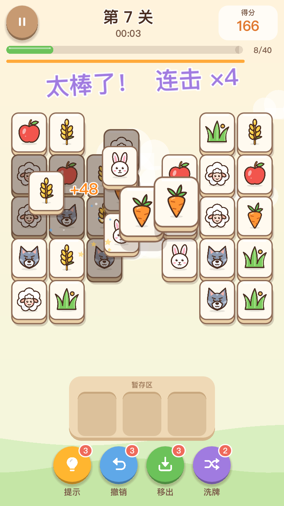

# 🐑 FLUFFY

A cute stack-and-match puzzle game built with Godot 4.6.

🌐 **[fluffy-idj.pages.dev](https://fluffy-idj.pages.dev)**

## Gameplay

- Tiles are stacked in layers, each layer offset by half a tile
- A tile is free when nothing on a higher layer overlaps it — covered tiles are shown dimmed
- Tap two free tiles with the same picture to clear them
- Clear the whole board to win; later levels bring bigger stacks and more tile kinds

## Features

- ✅ **11 board shapes** (sprout → hive, up to 78 tiles in 4 layers), 12 hand-drawn vector tile designs
- ✅ **Always solvable** — every board is generated by simulating a full clear, so a winning order exists
- ✅ **Power-ups**: Hint, Undo, Park (3-slot tray) and Shuffle — use them to break a dead end
- ✅ **Combo scoring** — clear again within 3 s for up to 3× points, with a draining combo meter
- ✅ **Daily Challenge** — one fixed board per day, same for everyone; per-day best and streak
- ✅ Star rating, per-level best score, level select
- ✅ Juicy feedback: deal-in animation, tiles fly together and burst, confetti, synthesized sound effects, haptics on phones
- ✅ Player profile (name + 12 avatars)
- ✅ Music / sound / vibration settings
- ✅ 3 languages: 简体中文 / 繁體中文 / English
- ✅ Fits any phone shape (safe areas, tall screens) and runs on desktop

## Download

- [Download APK](https://github.com/shizixian/FLUFFY/releases/latest) — arm64 only

## Screenshots

| Main Menu | Gameplay |
|:---:|:---:|
|  |  |

## Development

- **Engine**: Godot 4.6.3
- **Language**: GDScript
- **Resolution**: 720×1280 portrait base, expands to fit the screen

### Run

Open the project with Godot 4.6.3, press F5. Or from a terminal:

```bash
godot --path .
```

### Tests

```bash
godot --headless --path . --import                              # first run only (builds the import cache)
godot --headless --path . --script res://tests/run_tests.gd     # rules, generator, save migration
godot --headless --path . res://tests/ui_smoke.tscn             # drives the real UI end to end
```

Screenshots of every screen (uses its own save file):

```bash
godot --path . --resolution 360x640 res://tests/shot_runner.tscn -- out=/tmp/fluffy_shots vp=720x1280
```

## Credits

- Author: ShiZixian (Zan)
- Programming assistance: Claude Code

## License

MIT
