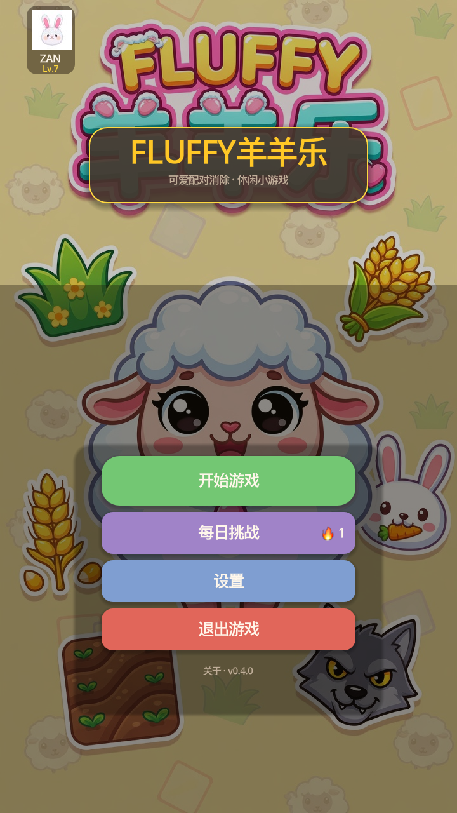
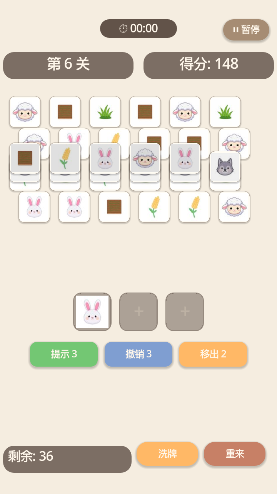

# 🐑 FLUFFY

A cute casual tile-matching puzzle game built with Godot 4.6.

🌐 **[fluffy-idj.pages.dev](https://fluffy-idj.pages.dev)**

## Gameplay

- Tap uncovered (free) tiles
- Select two matching tiles to eliminate them
- Clear all tiles to win
- Higher levels = more tiles, deeper stacks, increasing difficulty

## Features

- ✅ Progressive difficulty system with **5 board layouts** (diamond / pyramid / wide / classic / towers)
- ✅ Provably solvable layout generation (bottom-up reverse-pair placement — no retries, no dead boards)
- ✅ **Props**: Hint, Undo (full action history) and 3 Move-out slots per level
- ✅ **Combo scoring** — chain clears within 3s for up to 3× points
- ✅ **Daily Challenge** — one fixed, date-seeded board per day, with best score and streak
- ✅ Timer + star rating (≤3.5s per pair = ⭐⭐⭐)
- ✅ Player profile (name + avatar)
- ✅ BGM toggle control
- ✅ Shuffle & restart options
- ✅ 3 languages: 简体中文 / 繁體中文 / English

## Download

- [Download APK](https://github.com/shizixian/FLUFFY/releases/latest) — install directly on Android

## Screenshots

| Main Menu | Gameplay |
|:---:|:---:|
|  |  |

## Development

- **Engine**: Godot 4.6.3
- **Language**: GDScript
- **Resolution**: 720×1280 portrait

### Run

Open the project with Godot 4.6.3, press F5. Or from a terminal:

```bash
godot --path .
```

### Tests

```bash
godot --headless --path . --import          # first run only (builds the import cache)
godot --headless --path . --script res://tests/run_tests.gd
```

The suite checks generator solvability on levels 1–60, tile parity, props and undo,
slot matching, daily-challenge determinism, and plays several levels end to end.

## Credits

- Author: ShiZixian (Zan)
- Programming assistance: Grok & Claude Code

## License

MIT
